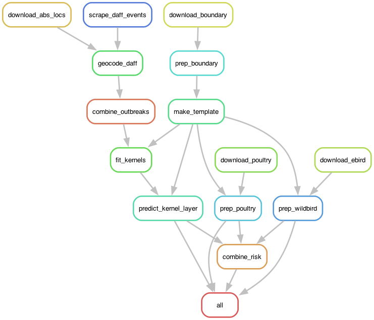

# HPAI H5N1 risk mapping for Australia

A reproducible Python and Snakemake workflow that maps the relative risk of HPAI H5N1 (clade 2.3.4.4b) across Australia, developed for the [WOAH Datathon](https://data-integration-department-woah.github.io/WOAH-Datathon/). It:

1. fits distance-transmission kernels to wild bird detections on a 25 km grid by maximum likelihood, comparing shapes by AIC;
2. prepares waterbird abundance and chicken density on the same grid;
3. combines them into relative risk maps for wild birds and for spillover to poultry.

The kernel is estimated from data. The risk maps combine it with the covariates using fixed, assumed rules: they rank cells, and are not probabilities of infection.

## Running the workflow

Requires [`uv`](https://docs.astral.sh/uv/) and an internet connection. Developed on macOS.

```bash
git clone https://github.com/meryltheng/h5n1-risk-australia.git
cd h5n1-risk-australia
uv sync
```

Before running:

- **eBird key.** Request a Status & Trends key at [ebird.org/st/request](https://ebird.org/st/request) and set it as an environment variable: add `export EBIRD_KEY="your-key"` to `~/.zshrc` (Windows: `setx EBIRD_KEY "your-key"`), then open a new terminal. Never put the key in a repository file.
- **WAHIS export.** WAHIS has no documented public API, so outbreak records are exported manually from the [WAHIS event 7649](https://wahis.woah.org/#/in-event/7649/dashboard). Save the expost at the path set by `outbreak_data: wahis_file` in `config/config.yaml`. The file used for the submitted results was exported on 10 August 2026.
- **DAFF snapshot.** The DAFF table can only be downloaded as it stands today, so an earlier snapshot cannot be recreated. The snapshot used for the submitted results, `data/raw/DAFF/events_by_species_20261021.csv`, is included and matches the default `outbreak_data: daff_snapshot: 20261021`. To use current data, set this to today's date (`YYYYMMDD`).

Then:

```bash
uv run snakemake -n          # dry run: list the steps
uv run snakemake --cores 4   # run
```

Steps whose outputs are up to date are skipped. All settings are in `config/config.yaml`. Downloaded data are not committed (GADM data may not be redistributed).

## Processing steps



Each rule runs a script in `workflow/scripts/`, usually of the same name. Shared code (kernel model, grid helpers, maps) is in `src/h5n1risk/`.

### Data acquisition

| Rule | Downloads | Output |
|---|---|---|
| `download_abs_locs` | ABS Suburbs and Localities 2021 | `data/raw/ABS/` |
| `scrape_daff_events` | [DAFF](https://www.agriculture.gov.au/campaigns/birdflu/latest-data) "Events by species" table, via its Power BI service | `data/raw/DAFF/events_by_species_{date}.csv` |
| `download_boundary` | GADM 4.1 national boundary (`general: country_iso3`) | `data/raw/GADM/` |
| `download_poultry` | FAO Gridded Livestock of the World v4 chicken density (2020) | `data/raw/FAO/GLW4-2020.D-DA.CHK.tif` |
| `download_ebird` | eBird Status & Trends weekly abundance for `ebird: waterbird_species`; unmatched species are skipped and recorded in the lookup | `data/raw/eBird/abundance/`, `species_lookup.csv` |

### Grid and covariates

- **`prep_boundary`** (`make_boundary.py`): clips the boundary to `general: extent_lonlat`, dissolves it and reprojects to `general: proj_crs`. → `data/processed/boundary.gpkg`
- **`make_template`**: builds the analysis grid of `general: cell_res_km` cells, starting at the boundary's south-west corner and keeping every cell the boundary touches. All later layers use this grid. → `data/processed/template.tif`
- **`prep_wildbird`**: reprojects each species onto the grid, averages weeks to months and sums across species. → `data/processed/waterbird_index.tif` (one band per month)
- **`prep_poultry`**: averages chicken density into grid cells. → `data/processed/poultry.tif`

### Outbreak data

- **`geocode_daff`**: matches DAFF records to ABS localities by name and state, placing each at a random point within its locality (`general: seed`). → `data/interim/daff_events_geocoded.csv`
- **`combine_outbreaks`**: merges DAFF and WAHIS records, flagging probable duplicates (same locality, date and species). → `data/processed/combined_outbreak_data.csv`

### Kernel and risk

- **`fit_kernels`**: assigns records to cells, builds the risk set (each cell's first detection) and fits the shapes in `kernel: kernels` under the timing assumptions in `kernel:`. → `results/kernel/`: `kernel_comparison.csv` (parameters, AIC), `kernel_fits.json`, `risk_set.csv`, `kernel_curves.png`
- **`predict_kernel_layer`**: sums the chosen kernel (`kernel_layer: predict_kernel`) over detected cells, scaled 0–1, with detected cells set to 1. → `results/kernel/kernel_layer.tif`, `.png`
- **`combine_risk`**: multiplies the kernel layer by waterbird abundance for month `risk: risk_month` (wild bird risk), then combines that with poultry density (`risk: spillover`, `risk: poultry_half_sat`) for spillover risk. → `results/risk/risk_layers.tif` (one band per layer), `risk_maps.png`

## Limitations

- The distance scale of the kernel (ρ₀) is not reliably estimable at 25 km resolution and depends on where the grid is placed. The tail exponent (ψ) and the fitted curves are the more robust results.
- Kernel shapes cannot be distinguished by AIC with these data.
- Nearby detections can reflect where carcasses are found and reported, not only transmission, so short-range spread may be overstated.
- DAFF locations are reported by locality only. Each record is placed at a random point within its locality.